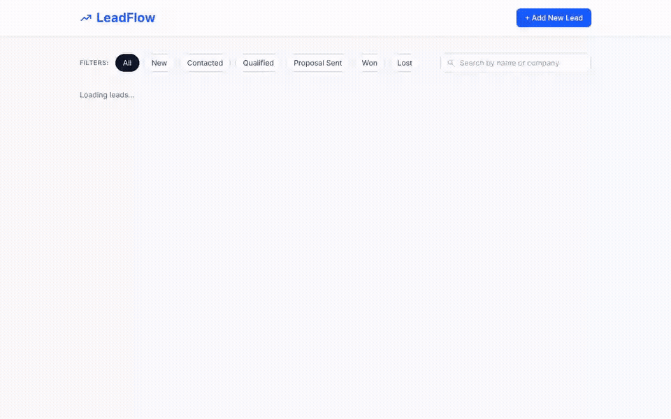
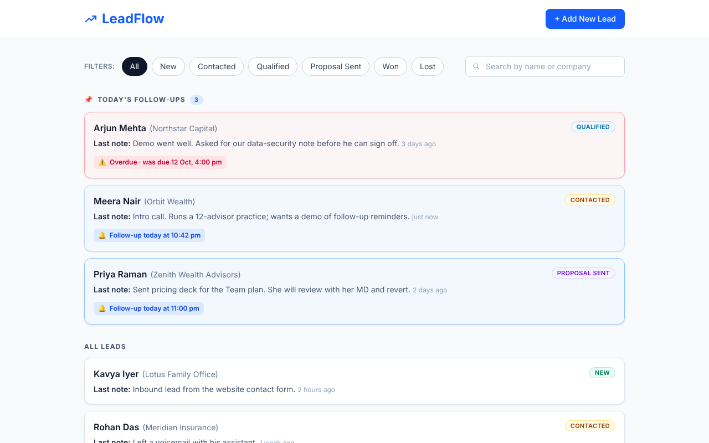
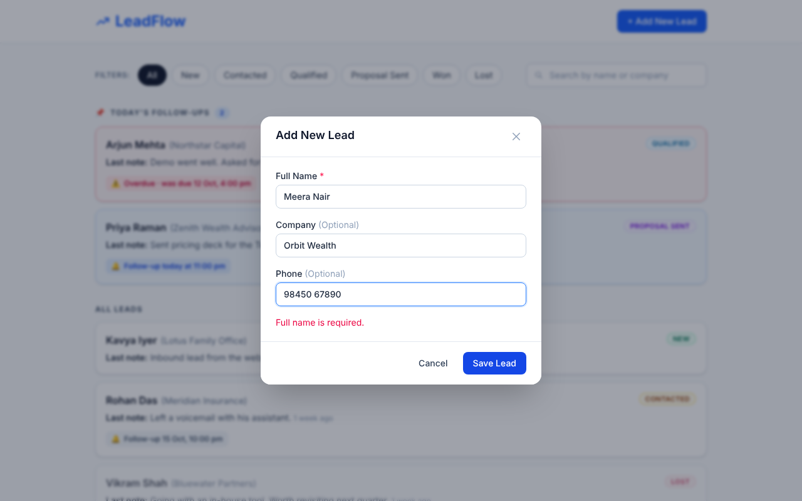
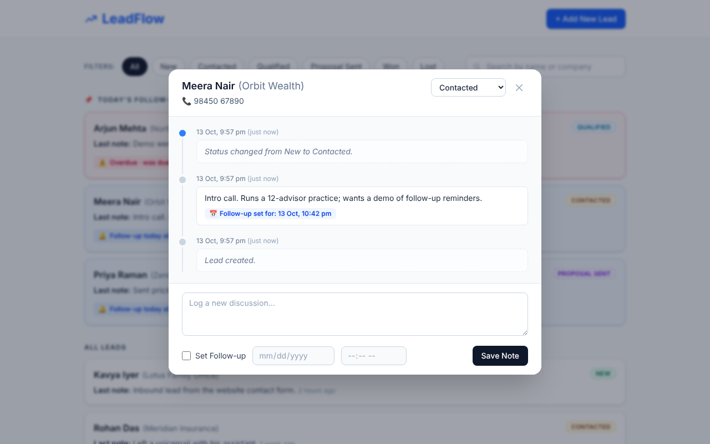

# LeadFlow

LeadFlow is a lightweight, single-screen CRM. A sales rep can track leads, log every discussion and set follow-up reminders that come back to the top of the list on the day they are due.

**Stack:** Next.js 15 (React 19, TypeScript, Tailwind) · FastAPI · SQLAlchemy 2 · SQLite locally / Postgres in Docker



> Full-quality video of the flow: [`docs/leadflow-demo.mp4`](docs/leadflow-demo.mp4) (30 s)

| Lead list | Add lead | Timeline dialog |
|---|---|---|
|  |  |  |

---

## Quick start

### Option A: Docker (one command)

```bash
cp .env.example .env          # optional, every value has a default
docker compose up --build
```

- App: http://localhost:3000
- API docs (Swagger): http://localhost:8000/docs

This starts Postgres, the API and the web app. The API seeds 6 demo leads on its first start.

### Option B: run locally (Python 3.11+, Node 20+)

**Backend**

```bash
cd backend
python -m venv .venv
source .venv/bin/activate          # Windows: .venv\Scripts\activate
pip install -r requirements-dev.txt
cp .env.example .env               # SQLite by default, no database to install
python -m app.seed                 # 6 leads, 19 discussions
uvicorn app.main:app --reload      # http://localhost:8000
```

**Frontend** (new terminal)

```bash
cd frontend
npm install
cp .env.example .env.local         # NEXT_PUBLIC_API_URL=http://localhost:8000
npm run dev                        # http://localhost:3000
```

The seed uses times relative to now, so there is always one follow-up **due today** and one **overdue**. Run `python -m app.seed --reset` to start fresh. "Today" is computed in `SEED_TZ` (default `Asia/Kolkata`).

### Tests

```bash
cd backend  && python -m pytest     # 29 API tests
cd frontend && npm test             # 15 tests for time-ago / pinning / timezone logic
cd frontend && npm run typecheck
```

GitHub Actions runs all of these, plus `next build`, on every push.

---

## What's covered

| Requirement | Where |
|---|---|
| List shows name, status badge, last note, time since last discussion | `LeadCard.tsx`; last note is denormalised on the lead, so the list is one query |
| Filter by status (New / Contacted / Qualified / Proposal Sent / Won / Lost) | `FilterBar.tsx` → `GET /api/leads?status=` |
| Today's follow-ups pinned at the top | `splitForList()` in `lib/time.ts`, computed in the **viewer's timezone** |
| Timeline dialog (not a page), newest first | `LeadDialog.tsx` → `GET /api/leads/{id}` |
| Add a note with an optional follow-up date and time; list updates immediately | `POST /api/leads/{id}/discussions` returns the updated lead, so the list changes without a refetch |
| Status update from the dialog persists | `PATCH /api/leads/{id}`, recorded in the timeline as "Status changed from X to Y" |
| Add new lead (name required, company/phone optional, status = New) | `AddLeadDialog.tsx` → `POST /api/leads` |
| **Bonus:** search by name | Debounced search box → `GET /api/leads?q=` (name or company) |
| **Bonus:** overdue follow-ups in red | Red card and "Overdue · was due …" chip; overdue leads are pinned too |
| **Bonus:** Docker Compose | `docker-compose.yml` (Postgres + API + web) |
| **Bonus:** seed script with 5+ leads and discussions | `backend/app/seed.py` (6 leads, 19 discussions) |
| **Bonus:** filters | Status filters combine with search |

## API

| Method | Path | Success | Errors |
|---|---|---|---|
| `GET` | `/api/leads?status=&q=` | 200 list, newest activity first | 422 unknown status |
| `POST` | `/api/leads` | **201** + `Location` header | 422 missing/blank name, field too long |
| `GET` | `/api/leads/{id}` | 200 lead + discussions (newest first) | 404 |
| `PATCH` | `/api/leads/{id}` | 200 updated lead | 400 empty body · 404 · 422 invalid status |
| `POST` | `/api/leads/{id}/discussions` | **201** `{discussion, lead}` | 404 · 422 blank note, follow-up in the past or without a timezone |
| `GET` | `/api/health` | 200 | |

Errors always come back as `{"detail": ...}`. Database failures return **503** with a generic message; the real error is logged, never sent to the client.

## Design decisions

- **Follow-up rules.** A note *with* a follow-up sets or replaces the lead's follow-up. A note *without* one clears a follow-up that is **already due**, because logging that conversation is what completes it, but leaves a future follow-up alone. Moving a lead to Won or Lost clears its follow-up, since closed deals don't need reminders.
- **Timezones.** Everything is stored and sent as UTC. A custom column type keeps SQLite and Postgres identical. "Due today" and "overdue" are decided in the browser, using the rep's own clock.
- **System events in the timeline.** "Lead created" and status changes appear in the history (styled differently) but don't replace the *last note* shown in the list, which stays the rep's own words.
- **Business rules live in `services.py`**, not in route handlers, so they can be tested and read on their own. Routes only map HTTP to services.
- **No global state library.** One `LeadBoard` component owns the list. Dialogs report changes back through `onLeadChanged`, which applies them instantly and then re-syncs with the server.

## Project structure

```
backend/
  app/
    main.py          FastAPI app, CORS, error handling
    models.py        Lead, Discussion, statuses, UTC datetime column
    schemas.py       request/response models and validation
    services.py      business rules (follow-ups, status changes)
    routers/leads.py HTTP layer
    seed.py          demo data
  tests/             pytest (in-memory SQLite per test)
frontend/
  src/
    app/             layout + page (single screen)
    components/      LeadBoard, LeadCard, LeadDialog, AddLeadDialog, Modal, FilterBar, SearchBox, StatusBadge
    lib/             api client, types, time helpers (+ tests)
docker-compose.yml
```

## Environment variables

| Variable | Used by | Default |
|---|---|---|
| `DATABASE_URL` | backend | `sqlite:///./leadflow.db` (Docker: Postgres) |
| `CORS_ORIGINS` | backend | `http://localhost:3000` |
| `SEED_TZ` | seed script | `Asia/Kolkata` |
| `SEED_ON_START` | Docker API container | `true` |
| `NEXT_PUBLIC_API_URL` | frontend | `http://localhost:8000` |
| `POSTGRES_USER` / `POSTGRES_PASSWORD` / `POSTGRES_DB` | Docker | `leadflow` |

See `.env.example`, `backend/.env.example` and `frontend/.env.example`.

## Use of AI

I built this with heavy use of an AI coding assistant (Claude by Anthropic), as the brief encourages. I reviewed the code, ran it and own every decision listed above. The end-to-end flow in the demo video was recorded with Playwright, which asserts at each step that the UI shows what it should.

## What I'd add next

Login (skipped as optional), pagination for large lists, browser notifications when a follow-up becomes due, and Alembic migrations instead of `create_all`.
